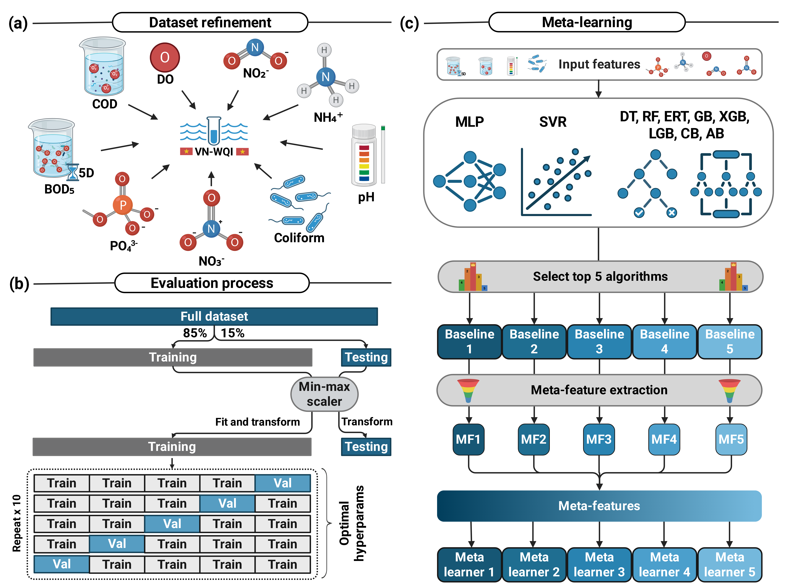

# xAquality



## Abstract

Coming soon...

## Online Demo (Hugging Face Spaces)

You can try the live demo of the application on Hugging Face Spaces here:
[https://huggingface.co/spaces/cbbl-skku-org/xAquality](https://huggingface.co/spaces/cbbl-skku-org/xAquality)

> **Note:** If the Space is currently "sleeping" due to inactivity, simply click the "Restart this Space" button and wait a few moments for it to wake up!

## Getting Started

### Preparing the Environment

This project requires **Python 3.12**.

To run this project locally, first clone the repository:

```bash
git clone https://github.com/nhattruongpham/xAquality.git
cd xAquality
```

#### Option A: Using Conda (Recommended)

You can create a fully configured Conda environment using the provided `environment.yml` file:

```bash
conda env create -f environment.yml
conda activate xaquality
```

#### Option B: Using pip

Alternatively, you can install the dependencies directly using `pip`:

```bash
pip install -r requirements.txt
```

*(Tip: We recommend creating a virtual environment using `python -m venv venv` before running pip to keep dependencies isolated.)*

## Running the Application

### 1. Web Dashboard (Gradio)

To launch the interactive dashboard for Single Sample and Batch Predictions:

```bash
python app.py
```

This will start a local web server (usually at `http://127.0.0.1:7860/`), where you can interact with the model via your web browser.

### 2. Command-Line Inference

To run predictions directly from the command line on a CSV dataset, use the `inference.py` script:

```bash
python inference.py
```

Make sure you configure the script to point to your specific input CSV file.

## About Us

Visit the **Computational Biology and Bioinformatics Laboratory (CBBL)** at Sungkyunkwan University (SKKU) to learn more about our research: [https://balalab-skku.org/](https://balalab-skku.org/)

## Citation

If you find this repository useful, please cite our work:

```bibtex
Coming soon...
```


# 💦 xAquality: Interpretable and Transferable AI for Water Quality Index Prediction

[](https://opensource.org/licenses/MIT)
[](https://huggingface.co/spaces/cbbl-skku-org/xAquality)

**xAquality** is a high-performance, AI-driven framework designed to predict the Water Quality Index (WQI) with high precision and interpretability. Utilizing a stacked ensemble architecture (Gradient Boosting + Voting Classifier), the model analyzes 9 key physicochemical and biological parameters to provide real-time assessment of water safety.


## 🧪 Key Features

- **Stacked Ensemble Model**: High-fidelity WQI prediction using optimized Stacking and Voting mechanisms.
- **Interactive Dashboard**: A responsive, emoji-enhanced interface for single-sample analysis.
- **Batch Processing**: Support for large-scale CSV uploads with real-time data preview and results download.
- **Interpretable Framework**: Designed for scientific transferability across different water monitoring stations.

## 📊 Input Parameters

The model accepts the following 9 parameters as per MONRE (2019) standards:

- **🧪 pH**: Acidity/Alkalinity level.
- **🫧 Dissolved Oxygen (DO)**: Essential for aquatic life health.
- **⚗️ COD & ⏳ BOD₅**: Measures of organic pollution.
- **🪴 PO₄³⁻ & 🧪 NH₄⁺**: Nutrient concentrations.
- **🧪 NO₂⁻ & 🧪 NO₃⁻**: Nitrogen compounds tracking.
- **🦠 Coliform**: Biological contamination metric.

## 🚀 Getting Started

### Installation

```bash
git clone https://github.com/nhattruongpham/xAquality.git
cd xAquality
pip install -r requirements.txt
```

### Run Locally

```bash
python app.py
```

### Run with Docker

The server deployment follows the SorbFormer service convention and routes the
application through the shared Traefik `proxy-network` at `/xAquality`.

Make sure the external network already exists on the server:

```bash
docker network create proxy-network 2>/dev/null || true
```

Build and start the Gradio application:

```bash
docker compose up -d --build
```

Open `https://balalab-skku.org/xAquality/`. Override the default route with:

```bash
SERVICE_NAME=xAquality SERVICE_DOMAIN=example.org docker compose up -d --build
```

To stop the service:

```bash
docker compose down
```

### CLI Inference

```bash
python inference.py --sample 7.0 5.5 15.0 8.0 0.05 0.1 0.05 2.0 5000
```

## ⚖️ License

This project is licensed under the MIT License - see the [LICENSE](LICENSE) file for details.

---

*Developed as part of the xAquality research framework for sustainable water management.*
